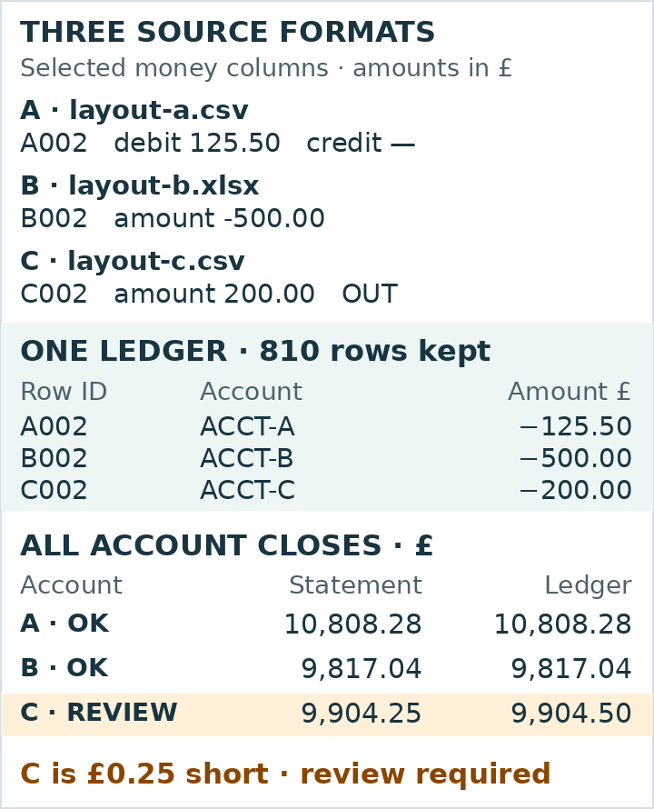

# Three bank statements, one checked ledger

Different money columns, one sheet. **810 transactions kept; two accounts balance, one statement is 25p short.**



[Source rows → ledger](media/README.md) · [All account checks](output/reconciliation.md)

<sub>Case 02 of 8 in [Excel & VBA casebook](../README.md)</sub>

## What was wrong

- Each statement showed money coming in and going out differently.
- Matching dates and amounts could belong to different accounts.
- Copying the transactions together would leave an incorrect balance unchecked.

## What I did

- I put the transactions in one sheet, and kept each original filename and row number beside it.
- I worked out the balance after every transaction, starting with the opening balance.
- I compared each account’s final balance with its statement and kept the accounts separate.
- I marked the difference for review and left the original amounts unchanged.

## Proof

| Measure | Source statements | Checked ledger |
|---|---|---|
| Coverage | [270 transactions per account, 1 Oct–31 Dec](output/report.json) | [810 retained; none excluded](output/report.json) |
| Money | [£54,544.50 in; £26,264.68 out](output/reconciliation.md) | [£28,279.82 net movement](output/reconciliation.md) |
| ACCT-C close | [£9,904.25 reported](input/layout-c.csv) | [£9,904.50 calculated; −£0.25 difference](output/exceptions.csv) |
| Account results | [Separate account settings](input/accounts.json) | [Two balance; one needs review](output/reconciliation.md) |

The balance after the last transaction and the final account total show the **same** difference. That account still needs review; its original figures remain unchanged.

**Download the .xlsx workbooks:** [before: statement overview](output/input-overview.xlsx) · [after: checked ledger](output/ledger-checked.xlsx) · [reconciliation](output/reconciliation.md) · [execution record](evidence/runtime.json)

**Original statements:** [layout A](input/layout-a.csv) · [layout B](input/layout-b.xlsx) · [layout C](input/layout-c.csv) · [account settings](input/accounts.json)

**See the detail:** [original layouts](images/statement-layouts.png) · [all account checks](images/balance-checks.png) · [flagged row and its source](images/trace-a-balance.png)

## Try it yourself

Optional technical check for a developer:

```bash
./run.sh
```

This produces the .xlsx workbooks and balance checks in `output/`, prints **PASS**, and keeps the difference marked **REVIEW**. [Developer setup and next quarter’s files](evidence/INPUTS.md).

A developer can reuse the check with new statements in the [supported layouts](evidence/INPUTS.md#input-format); a different bank layout needs its columns mapped first.

## How it is tested

[](https://github.com/Ardholt/excel-vba-casebook/actions/workflows/ci.yml)

- [30 tests passed](output/checks.txt): source rows and money are conserved, including same-day transactions, charges, credits and separate accounts.
- Tests expose incorrect balances and invalid records, and verify unchanged sources and safe repeat runs with [replacement inputs](evidence/input-options.json).
- The .xlsx workbooks were produced with [Python 3.12.3 / openpyxl 3.1.2 and checked with LibreOffice 24.2.7.2; 9,055 saved cell values matched](evidence/runtime.json).

<sub>Maintained by Genco Doganay, Ardholt</sub>

---

The [price below](https://ardholt.com/p/prices/) is based on statement pages, not transaction count. For a quarterly job, I confirm the page count and price before starting.

Order through the platform.

[£10 fixed, up to 15 pages, every figure keyed twice and balances tied, 2 working days.](https://ardholt.com/p/prices/)

This case at its size (a quarter of statements, 810 transactions): £20-£30 fixed, quoted from the page count before I start.

More rows or pages: I quote the difference in writing before I start.
