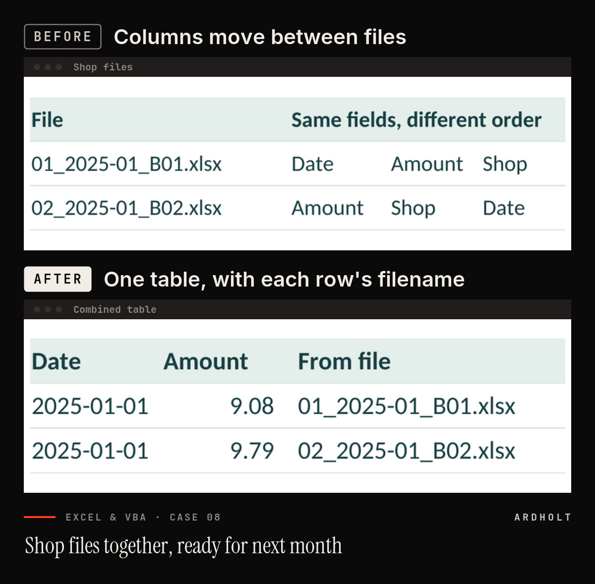

# 50 Shop Files: 5,520 Rows in One Monthly Table

<p align="center">
  
</p>

**[5,520 rows from 46 filled files](output/report.json), together in one table. [Refreshing again doesn't double your figures.](evidence/vba-run.json)**

<sub>Case 8 of 8 in [Excel & VBA casebook](../README.md)</sub>

## What was wrong

- Each shop's monthly figures are in a separate spreadsheet.
- The columns moved around, so copying and pasting could put figures in the wrong place.
- Empty files and files with missing columns needed attention before they could be included.

## What I did

- I matched columns by their names, keeping the extra details some shops supplied.
- I kept the original filename and row number beside each entry so it could be checked.
- I listed files that needed fixing, instead of silently losing them.
- I set up a repeatable update and checked that adding a file brings in its entries once.

## Proof

The picture shows [entries from the finished table](evidence/table-preview.json), with their original filenames. Open the [full combined spreadsheet](output/consolidated.xlsx) to see all the rows.

| What was checked | What happened |
|---|---|
| All the shop files | [50 files: 46 filled, 2 empty, 2 needing fixes](output/manifest.csv) |
| Files needing fixes | [One is missing the amount column; one is missing the data sheet](output/rejections.csv) |
| Temporary editing file | [1 ignored; separate from the 50 shop files](output/report.json) |
| Entries brought together | [5,520 rows; amounts add up to 238,441.92](output/evidence.txt) |
| Update again | [Still 5,520 rows, with every value unchanged](evidence/vba-run.json) |
| Add a file containing another entry | [5,521 rows, matching the enlarged source folder](evidence/vba-run.json) |

**Download:** [original shop files](https://github.com/Ardholt/excel-vba-casebook/tree/main/combine-many-files/input/files) · [finished spreadsheet](output/consolidated.xlsx) · [files needing attention](output/rejections.csv) · [workbook with the update macro](combine.xlsm).

## Try it yourself

Optional technical check for a developer, from this folder with Docker running:

```bash
./run.sh
```

It rebuilds the output, checks the results and prints `PASS: combine checks`. [Developer setup and file requirements](USAGE.md).

## How it is tested

[](https://github.com/Ardholt/excel-vba-casebook/actions/workflows/ci.yml)

Run in: [LibreOffice Calc 24.2.7.2 (headless)](evidence/runtime.json), the macro checked against an independent Python reference. Microsoft Excel: not yet run. Power Query (M) query included; not yet run in Excel.

[14 passing tests](evidence/tests.json) check row counts, amount totals, every source value and unchanged input files. They cover reordered columns, extra fields, empty and invalid files, temporary files, repeat updates and a newly added file. The [actual VBA run](evidence/vba-run.json) matched the reference cell by cell; its saved workbook used UNO export rather than VBA SaveAs.

For the developer checking the implementation: [tests](tests/test_combine.py) · [VBA source](vba/CombineFiles.bas) · [Power Query source](power-query/CombineFolder.m) and [setup](power-query/SETUP.md) · [versions and execution evidence](evidence/runtime.json).

---

[£39 fixed as one task automated, 5 working days.](https://ardholt.com/p/prices/) This covers one shared folder-to-table setup across your shops. I confirm the files and layout through the platform before starting.

For work beyond that setup, I quote any difference in writing before I start.
