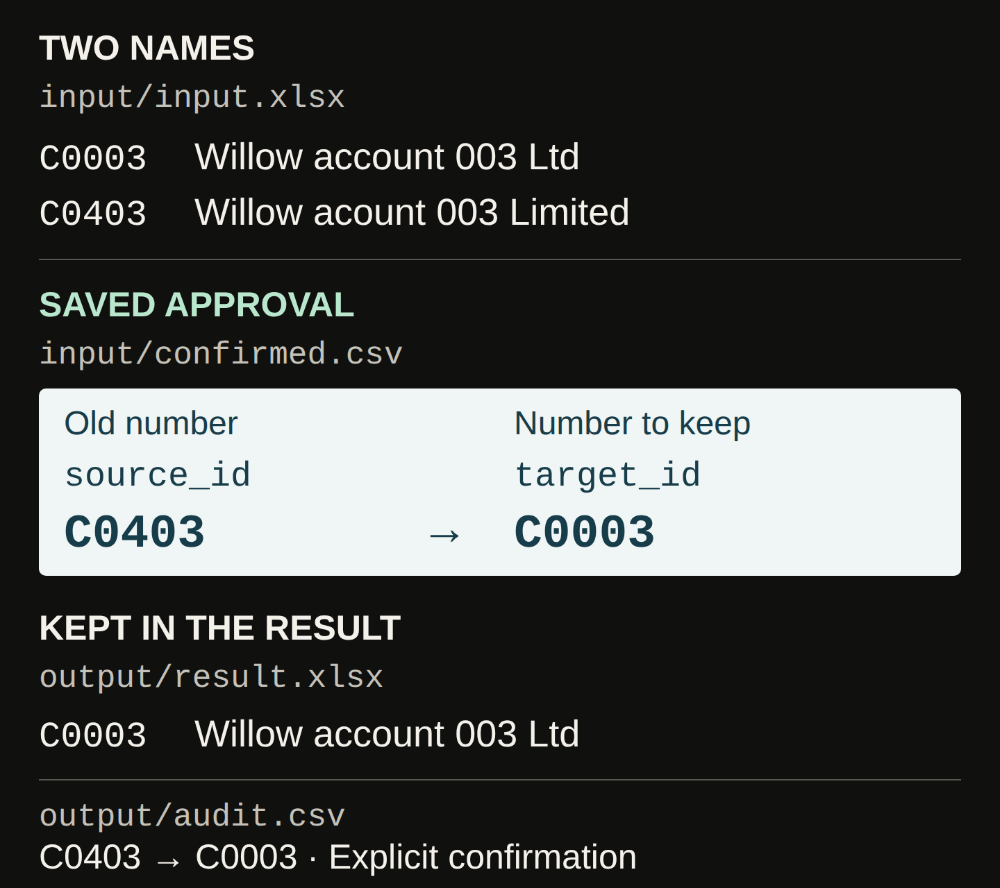
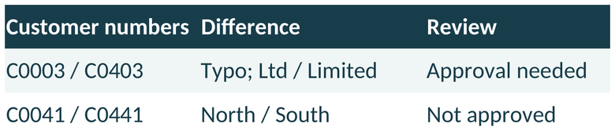
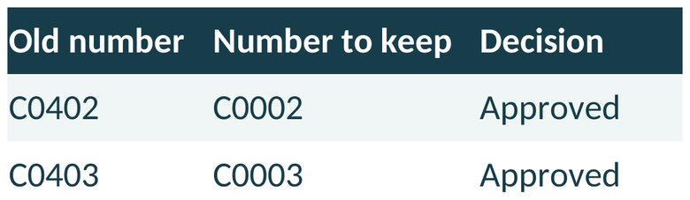

# Join customers only with approval

A typo and “Ltd” versus “Limited” can hide a repeated customer. The saved approval below authorises this join.

<p align="center">
  
</p>

**[Open the approval record](input/confirmed.csv): `C0403 → C0003`.** Old number → number to keep. Without that approval, these entries stay separate.

**[480 entries became 440. Only the 40 approved pairs were joined; every original entry is recorded.](output/evidence.md)**

<sub>Case 03 of 8 in [Excel & VBA casebook](../README.md)</sub>

## What was wrong

- Spelling mistakes and shortened names made the same customer appear more than once.
- Similar names could also belong to different customers.
- Joining them by name alone could combine the wrong customers.

## What I did

- I listed possible matches with a reason beside each pair.
- I made each join depend on approval: the old customer number and the customer number to keep.
- I kept the chosen customer's details and recorded what happened to every original entry.
- I made incorrect approvals stop the changes, with a list of what needs correcting.

## Proof

| Check | Result |
|---|---|
| Starting list | [480 customer entries](output/report.json) |
| Suggestions to review | [79 pairs](output/proposed.csv) |
| Approved joins | [40 pairs](input/confirmed.csv) |
| Finished list | [440 customer entries](output/report.json) |
| Suggestions left separate | [39 pairs without approval](output/report.json) |
| Original entries accounted for | [All 480; none lost](output/report.json) |

The [North/South pair stays separate](output/audit.csv), even though its names are close. The opening picture shows a [typo and Ltd/Limited spelling difference](output/proposed.csv), the exact [confirmation row](input/confirmed.csv) and the resulting [audit entry](output/audit.csv). To approve a join, save the old number and the number to keep in the approval list, then rerun against the original register. You can also approve a match that the suggestions missed; [the approval checks](tests/test_customers.py) still apply.





**Download the .xlsx workbooks:** [before](input/input.xlsx) · [after](output/result.xlsx) · [checked copy](output/checked.xlsx).

**Review files:** [approval list](input/confirmed.csv) · [blank approval list](output/confirmed-template.csv) · [record of every original entry](output/audit.csv).

## Try it yourself

Optional technical check for your developer. With the repository and Docker ready, run this from the case folder:

```bash
./run.sh
```

It rebuilds the .xlsx workbooks and prints PASS or FAIL. Open `output/result.xlsx` for the result. [Setup, your own files and how suggestions are selected](SCHEMA.md).

## How it is tested

[](https://github.com/Ardholt/excel-vba-casebook/actions/workflows/ci.yml)

- [Tests](tests/test_customers.py) check that every entry is accounted for, unapproved pairs stay separate and repeated runs give the same result. [Recorded results](output/test-results.json).
- Incorrect approvals must leave the whole customer list unchanged, including conflicting choices and circular links.
- The .xlsx workbooks were produced with [Python 3.12.3 and openpyxl 3.1.2, then checked with LibreOffice 24.2.7.2](evidence/runtime.json). Every sheet's values were compared after reopening and saving.

---

[£45 fixed, up to 5,000 rows, the confirmed list with every merge logged, 3 working days.](https://ardholt.com/p/prices/) Order through the platform.

More rows or pages: I quote the difference in writing before I start.
