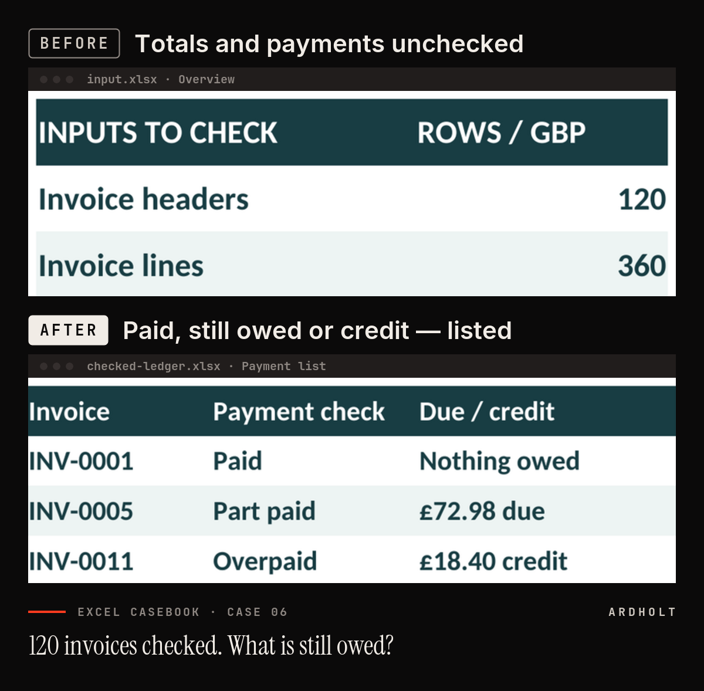
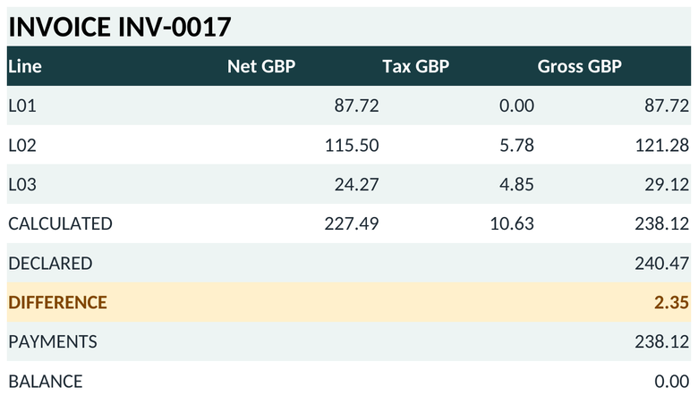

# Invoices that don’t add up: 7 totals flagged

<p align="center">
  
</p>

**[120 invoices checked; 7 totals need review.](output/reconciliation.md) The payment list shows what is paid, what is still owed and what needs checking.**

<sub>Case 06 of 8 in [Excel & VBA casebook](../README.md)</sub>

## What was wrong

- Some invoice totals did not match the amounts on their lines.
- Repeated payment references could make an invoice look more fully paid than it was.
- Part-payments, money returned and extra payments made it hard to see what was still owed.

## What I did

- I added up each invoice’s lines and tax, then checked its stated total.
- I matched payments to invoices and set repeated entries aside for checking.
- I made a clear list of what is paid, what is still owed and where there is money to return or use as credit.
- The `.xlsx` workbooks contain that payment list and a separate list of entries to review.

## Proof

The [Payment list in the checked workbook](output/checked-ledger.xlsx) shows each invoice’s payment position. Entries with questionable payments are marked **Check payment**, so they can be reviewed before asking someone to pay again.

| What you can see | Result from these files |
|---|---|
| Invoices checked | [120 invoices, with 360 lines](output/report.json) |
| Totals needing review | [7, overstated by £16.45 altogether](output/reconciliation.md) |
| Payments matched to invoices | [£40,326.02 across 119 entries](output/reconciliation.md) |
| Repeated payment references | [6 entries sharing 3 references, set aside for checking](output/report.json) |
| Payments with no matching invoice | [4 entries, £183.15 altogether](output/reconciliation.md) |

Every [payment entry is kept in the payment file](output/payments.csv). The repeated entries need checking against the payment records before anyone can say how much of them was actually received. They are not counted as additional money received.



For [INV-0017](output/invoices.csv), the lines add up to **[£238.12](output/lines.csv)**; the invoice states **[£240.47](input/input.xlsx)**. The **[£2.35 difference](output/exceptions.csv)** stays on the review list. Its **[£238.12 payment](output/payments.csv)** covers the calculated total, so the issue is the invoice total rather than a missing payment.

**Download:** [original workbook](input/input.xlsx) · [checked workbook with payment list](output/checked-ledger.xlsx) · [invoice views](output/invoice-views.xlsx) · [entries to review](output/exceptions.csv) · [full reconciliation](output/reconciliation.md)

## Try it yourself — optional developer check

A developer can reproduce the checks with Docker from this case folder:

```bash
./run.sh
```

It rebuilds the files and prints `PASS` or `FAIL`. [Setup and instructions for another input workbook](docs/USAGE.md).

## How it is tested

[](https://github.com/Ardholt/excel-vba-casebook/actions/workflows/ci.yml)

The `.xlsx` workbooks were produced with [Python 3.12.3 and openpyxl 3.1.2](evidence/runtime.json), then checked with [LibreOffice 24.2.7.2: all 1,920 recalculated formula cells matched](evidence/runtime.json).
[31 tests passed](evidence/runtime.json), covering rounding, refunds, part-payments, repeated payment references and payments with no matching invoice.
The tests also check that no records disappear, the input stays unchanged and repeat runs give the same result. [Tests](tests/test_reconcile.py) · [replacement-input checks](evidence/replacement-input.json) · [technical rules and workbook tabs](docs/USAGE.md).

---

The files above show [120 invoices](output/report.json). The offer below covers a smaller batch; for your larger pile, I quote the total through the platform before I start.

[£10 fixed, up to 20 invoices, net/VAT/gross that checks itself, 2 working days.](https://ardholt.com/p/prices/) Order through the platform.

This case at its size (120 invoices): £60 fixed, £10 for each 20 invoices.

More rows or pages: I quote the difference in writing before I start.
