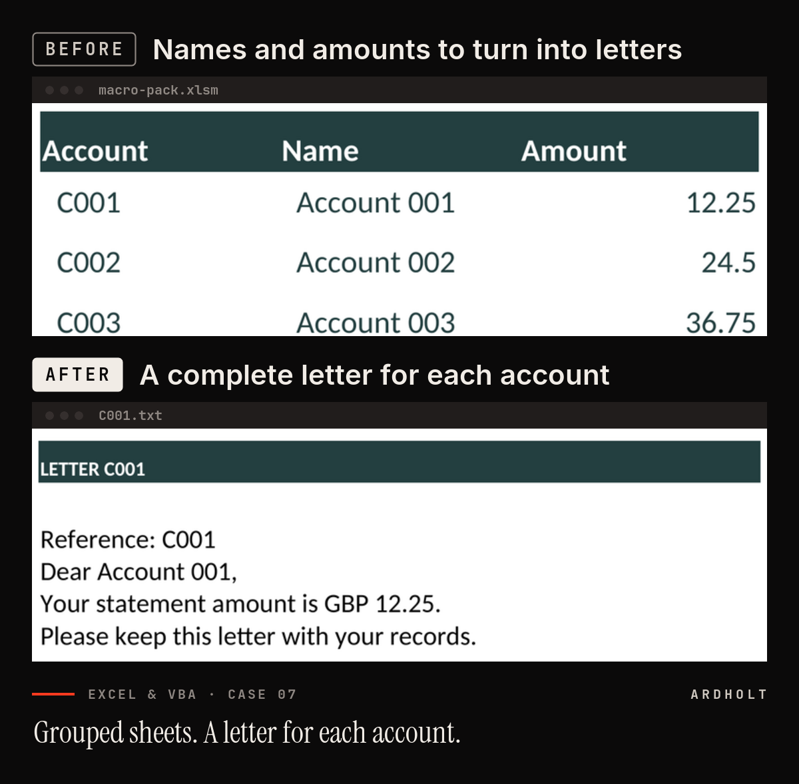
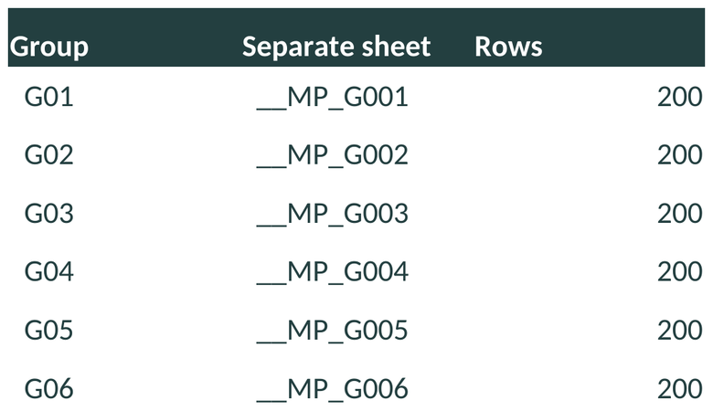
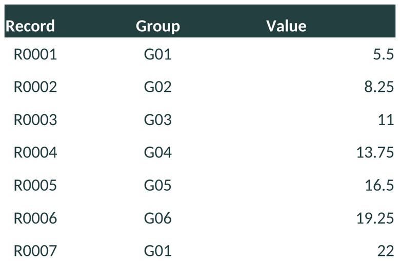
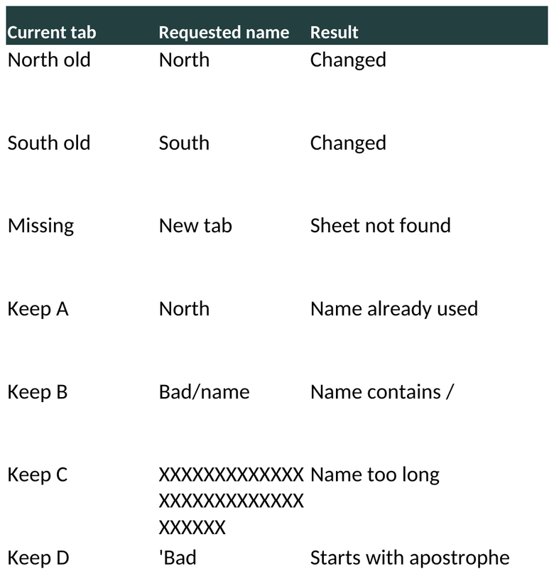

# Separate workbooks. Finished letters.

Splitting rows into files and copying account details into letters by hand invites mistakes.

**[1,200 rows → 6 separate workbooks](output/split-workbooks.zip)** · [Check every group](output/split.csv)



[Read this letter](output/letters/C001.txt) · [Download all 80 letters](output/letters.zip)

<sub>Case 07 of 8 in [Excel & VBA casebook](../README.md)</sub>

## What was wrong

- Sorting rows into separate files by hand made it easy to miss one.
- Combining tables put values under the wrong headings, and some requested tab names could not be used.
- Each letter needed the right account name and amount, without copying another account's details.

## What I did

- I made a separate workbook for each group and checked that every row was kept.
- I combined the tables by their headings, keeping repeated rows rather than silently removing them.
- I changed the usable tab names and left the others untouched, with a reason for each.
- I prepared a complete letter for each account, ready to review. The letters are saved as files; they are not sent.

## Proof

**Separate files, with every row accounted for.** The [group list](output/split.csv) maps all [6 groups and 1,200 rows](output/report.json) to their own workbooks. [Download the six workbooks together](output/split-workbooks.zip), or open [the first group’s workbook](output/split/group-001.xlsx). Each contains only that group’s rows and the column headings. The [summary workbook](output/after.xlsx) holds the file list and the other results.



**One table with the headings lined up.** [480 rows plus 360 rows become 840 rows](output/report.json), including [12 repeated rows kept intact](output/report.json). These are the opening rows; [download the complete table](output/merged.csv).



**Every requested tab change explained.** All [7 requests](output/renames.csv) appear below: [2 names changed and 5 left unchanged](output/report.json). No existing tab was overwritten.



**A finished letter for each account.** The hero shows [the first complete letter](output/letters/C001.txt), with its own name and amount. [Download all 80 letters](output/letters.zip), or read [the last letter](output/letters/C080.txt). The [recipient list](input/input.xlsx) lets you check each one.

**Workbooks:** [before](input/input.xlsx) · [after](output/after.xlsx) · [macro workbook](macro-pack.xlsm). **Details:** [letter template](input/template.txt) · [result report](output/report.json) · [run log](output/run.txt).

## Try it yourself

Optional technical check for a developer, from this folder with Docker installed:

```bash
./run.sh
```

It rebuilds the reference output and runs the checks. [Setup, input format and macro instructions](USAGE.md).

## How it is tested

[](https://github.com/Ardholt/excel-vba-casebook/actions/workflows/ci.yml)

Run with Python/openpyxl for the reference outputs and business tests, and LibreOffice Calc 24.2.7.2 (headless) for the imported macros. Each macro’s result is checked against the source data and reference outputs.

The [tests](tests/test_business.py) check row and value conservation, header alignment, duplicate preservation, rejected renames, exact letter contents and repeat runs. [Test results](evidence/tests.txt) · [versions, timings and VBA checks](evidence/runtime.json).

Split checks open every generated `.xlsx` as an OOXML workbook and compare its headings, rows and values, including repeated rows. They also cover a new group, unsafe group labels, removed groups, empty input and repeat runs. Numbered filenames keep group labels out of file paths. The ZIP contents are checked against the individual files.

The command above runs the Python reference and its tests; the [separate VBA runner](scripts/run_vba.py) executes the imported macros. The split macro uses LibreOffice’s native OOXML export in that run; its Excel branch uses `Workbook.SaveAs`. [Macro-produced group workbooks](output/vba/split/) are retained separately from the Python downloads.

The retained before/after animations use workbook snapshots from those macro runs: [split](images/split.gif), [merge](images/merge.gif), [rename](images/rename.gif), [letters](images/letters.gif). The full [split](output/vba/split-after.xlsx), [merge](output/vba/merge-after.xlsx), [rename](output/vba/rename-after.xlsx) and [letter](output/vba/letters-after.xlsx) snapshots are available to inspect.

The [publishing correction record](evidence/publishing-corrections.json) documents the instruction-only edit to Instructions!C2 in the downloads and snapshots. Runtime measurements and [recorded hashes](evidence/checksums.json) remain historical; no macros were rerun for that edit.

Readable VBA: [split](vba/SplitRows.bas) · [merge](vba/MergeTables.bas) · [rename](vba/RenameSheets.bas) · [letters](vba/MakeLetters.bas).

---

[£39 a task automated, 5 working days.](https://ardholt.com/p/prices/) Order through the platform.
More rows or pages: I quote the difference in writing before I start.
