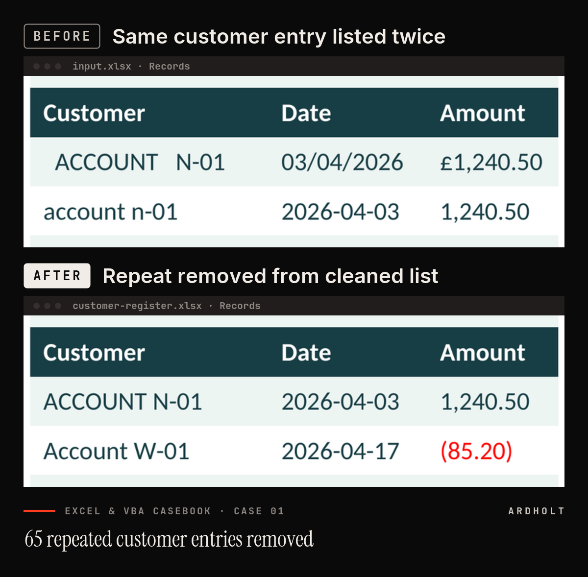

# Customer list with duplicates: 65 repeat entries removed

<p align="center">
  
</p>

**[All 550 entries accounted for: 472 kept, 65 repeats removed and 13 saved for review.](output/report.json)**

<sub>Case 01 of 8 in [Excel & VBA casebook](../README.md)</sub>

## What was wrong

- The same customer entry appeared with different spacing, capitalization and date formats.
- Amounts mixed currency signs, thousands separators and brackets for negatives.
- Impossible dates and unreadable amounts needed review before the list could be used.

## What I did

- I made dates and money amounts consistent and preserved customer numbers, including starting zeros.
- I removed a repeat only when the customer number, name, date and amount all matched after cleanup.
- I kept a record of every removed repeat and saved doubtful entries separately with the reason they need review.
- I checked every entry and the money totals, then ran the cleanup again to confirm the result stays the same.

## Proof

- **Every entry accounted for:** [550 source entries = 472 kept + 65 repeats removed + 13 saved for review](output/report.json).
- **Money accounted for:** [220,259.68 in valid entries = 194,075.70 kept + 26,183.98 in removed repeats](output/summary.md). Entries needing review are kept separately and excluded from these totals.
- **Stable result:** [running the cleanup again makes no further changes](evidence/runtime.json).

The picture shows the opening entries before cleanup and the cleaned list afterwards. The repeated Account N-01 entry is gone; Account W-01 moves up. Matching also checks the customer number, date and amount. [Trace the pictured entries](evidence/proof-source.json) · [Larger before view](images/before.png) · [Larger after view](images/after.png).

**Download the .xlsx workbooks:** [original list](input/input.xlsx) · [cleaned list with review tabs](output/customer-register.xlsx) · [copy checked in LibreOffice](output/calc-checked.xlsx).

**Follow any change:** [what changed](output/changes.csv) · [removed repeats and the entries kept](output/duplicates.csv) · [entries needing review](output/rejected.csv) · [decision for every entry](output/audit.csv).

## Try it yourself

**Optional technical check for a developer:** from this case folder, with Docker running:

```bash
./run.sh
```

This rebuilds the cleaned workbook in `output/`, runs the checks and prints PASS. [Developer setup and input requirements](USAGE.md).

## How it is tested

[](https://github.com/Ardholt/excel-vba-casebook/actions/workflows/ci.yml)

- [37 tests](output/standalone-tests.txt) check date order, identifiers, invalid values, duplicate links, changed inputs and exact record/money totals.
- [Executed checks](evidence/runtime.json) verify repeatability, unchanged sources and every sheet's values after a LibreOffice load/export; [folder names containing spaces](evidence/path-options.json) also passed.
- The .xlsx workbooks were produced and checked with [Python 3.12.3, openpyxl 3.1.2, LibreOffice 24.2.7.2 and pytest 7.4.4](evidence/runtime.json).

---

[This kind of job: £45 fixed, up to 5,000 rows, cleaned with every change logged and summed on one page, 3 working days.](https://ardholt.com/p/prices/)

More rows or pages: I quote the difference in writing before I start.

Order through the platform.
