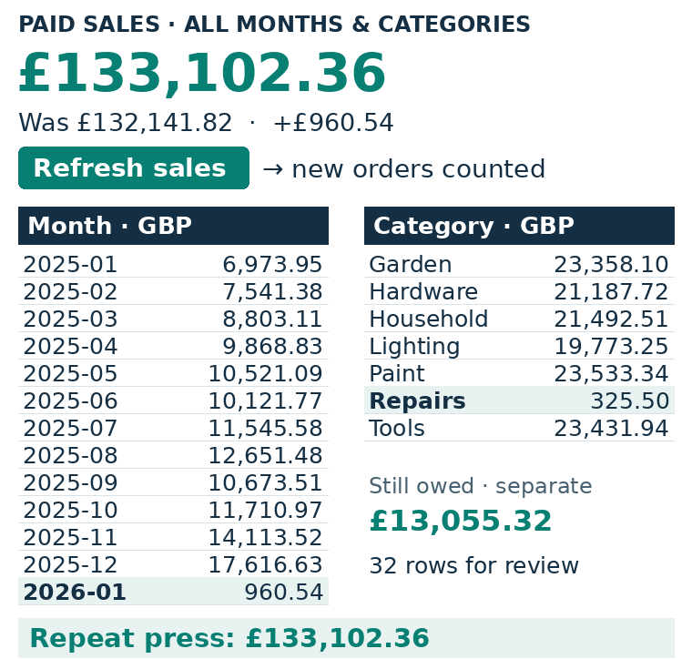
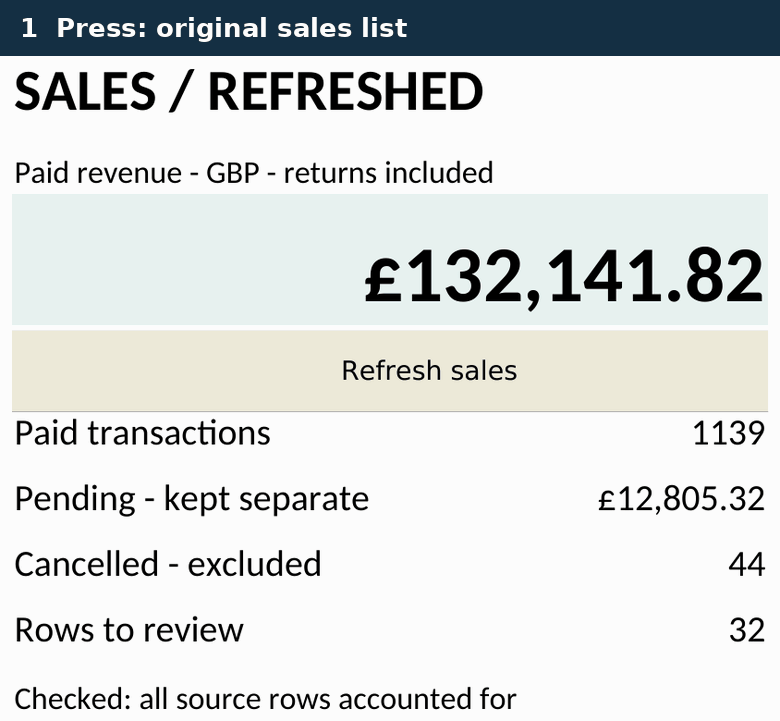

# New sales missing from the dashboard?

**One refresh adds £960.54: [£132,141.82 → £133,102.36](output/reconciliation.md).** Refunds are deducted; refreshing again keeps the same total.

<p align="center">
  
</p>

**Staff:** add sales → click **Refresh sales** → check **Audit** → save. [Download the button workbook](output/sales-dashboard.xlsm) · [See the button run](#the-button-in-use).

<sub>Case 04 of 8 in [Excel & VBA casebook](../README.md)</sub>

## What was wrong

New orders were in the sales list but missing from the dashboard. Refunds needed taking off, while unpaid and cancelled orders needed keeping out of paid sales. Repeated order numbers and incomplete entries needed checking before they could be counted.

## What changed

The refresh rebuilds the total, monthly breakdown and category breakdown from the sales list. It includes the new January sales and Repairs category, keeps money still owed separate, and lists each rejected entry with a reason. The original sales list stays intact.

[1,332 entries = 1,300 accepted + 32 for review](output/reconciliation.md). [£13,055.32 still owed](output/report.json) stays outside paid sales. The [row-by-row record](output/audit.csv) explains every decision.

## The button in use

The **Refresh sales** button is already installed in the [workbook](output/sales-dashboard.xlsm). The download contains the refreshed result shown above.

[Recorded button actions](output/vba-run.json), with the resulting saved workbooks:

| Action | Paid sales | Saved result |
|---|---:|---|
| Press with the original sales list | £132,141.82 | [Before](output/vba-before.xlsx) |
| Add the 12 new entries, then press | £133,102.36 | [After](output/vba-after.xlsx) |
| Press again | £133,102.36 | [Repeat](output/vba-repeat.xlsx) |

<p align="center">
  
</p>

Saved-view replay of the recorded button presses; the figures come from the three linked workbooks.

The saved macro workbook was then reopened and its button pressed again; all totals and rows still matched. [Full-size summary](images/breakdown.png) · [Workbook view](images/dashboard.png).

For staff, each refresh is:

1. Open the workbook in desktop Excel and enable its macros after reviewing the source. The button is on **Dashboard**, below the total.
2. Add new rows at the bottom of **Sales**, using the existing columns and keeping the header once.
3. Click **Refresh sales**. Look for **“Checked: all source rows accounted for”** below the total.
4. Check **Audit** for rejected rows. Correct those entries in **Sales**, refresh again, then save. Keep personal notes outside the derived tabs.

The supplied workbook already contains the new entries. For a rehearsal from the earlier state, follow the [before-state setup and refresh procedure](vba/README.md); do not append the sample entries to the finished download.

**Files:** [button workbook](output/sales-dashboard.xlsm) · [before](output/vba-before.xlsx) · [after](output/vba-after.xlsx) · [repeat](output/vba-repeat.xlsx) · [sales list](input/input.xlsx) · [totals and checks](output/reconciliation.md).

## Try it yourself

From this folder in the full repository, with Docker running:

```bash
./run.sh
```

Rebuilds the macro workbook from source, activates its installed button for the before, added-sales and repeat checks in LibreOffice, saves fresh results, then reopens the saved macro workbook and activates its button again. It also recalculates the independent Python reference and runs the business tests. A failure returns a nonzero exit code.

All workbooks and run records go to `output/`. Use `./run.sh --input /path/to/input --output /path/to/results` for separate folders. [Setup](DEPENDENCIES.md) · [input format](input/SCHEMA.md) · [VBA source and setup](vba/README.md).

## How it is tested

[](https://github.com/Ardholt/excel-vba-casebook/actions/workflows/ci.yml)

- **LibreOffice Calc 24.2.7.2, headless:** the [button run](output/vba-run.json) activates the imported Forms control through `XAccessibleAction.doAccessibleAction(0)`. Its `actionPerformed` binding invokes the embedded `Module1.RefreshDashboard`. This is an accessibility button press, not a physical mouse click. Each phase starts with cleared derived rows and an invalid total, so a stale workbook cannot pass.
- Every source value, accepted row, audit decision, total, breakdown and chart range is compared with the independent Python calculation. Each saved snapshot is read back and checked. The final `.xlsm` is saved with its VBA document module names preserved, reopened, and its button retested; [module extraction](output/macro-package.json) verifies the VBA source survives the save unchanged.
- **Python and LibreOffice formula recalculation:** [business tests](output/tests.json) cover totals, refunds, unpaid/cancelled orders, duplicate IDs, invalid entries, moved headers and repeat runs. [Reference runtime](output/runtime.json) records the formula-only calculation separately.

The summary graphic above is typeset from the [saved button-run values](evidence/hero.json). [Page previews](evidence/page-runtime.json) record the local phone and laptop render checks.

---

[£45 fixed, up to 5,000 rows, 3 working days.](https://ardholt.com/p/prices/)

More rows or pages: I quote the difference in writing before I start. Order through the platform.
