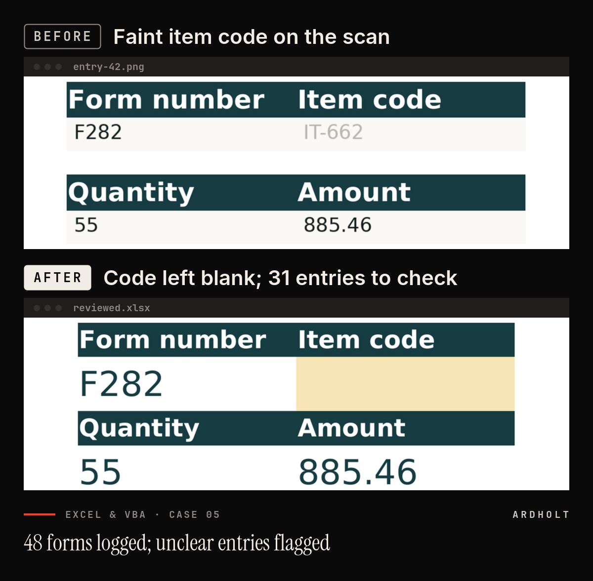

# Scans to a spreadsheet

48 forms to Excel, with doubtful entries left blank for checking.

[**153/192 fields correct on first reading; 161/192 after 8 supplied corrections.**](output/accuracy.json) 0 wrong values accepted in this batch against the answer key.



[Scan F282](input/forms/entry-42.png) → [complete saved row](output/reviewed.xlsx) · [image sources](evidence/hero-source.json)

**31 fields still to check** · [Full queue](output/unresolved.csv). Two examples with uncertain readings:

| Form | Check against the scan |
|---|---|
| [F242](input/forms/entry-02.png) | quantity |
| [F282](input/forms/entry-42.png) | item code |

<sub>Case 05 of 8 in [Excel & VBA casebook](../README.md)</sub>

## What was wrong

- Clear figures and unreadable marks were mixed together in the scans.
- A guessed amount could look like a finished entry in the sheet.
- A blank cell alone would not tell the owner what needed checking.

## What I did

- I put form numbers, item codes, quantities and printed amounts into .xlsx workbooks.
- I left doubtful entries blank and listed where to find each one on the scan.
- I applied supplied corrections and kept a record of what changed.
- I made the process reusable for fresh batches in the same form layout, with a new workbook and check list each time. [Batch instructions](RUNNING.md).

## Proof

| Entries checked against the answer key | First reading | After corrections |
|---|---:|---:|
| Read correctly | [153](output/accuracy.json) | [161](output/accuracy.json) |
| Still need checking | [39](output/accuracy.json) | [31](output/accuracy.json) |
| Wrong values passed through as correct | [0](output/accuracy.json) | [0](output/accuracy.json) |

Each form has a form number, item code, quantity and amount: [192 entries altogether](output/accuracy.json). The amount is copied as printed; the form has no unit price or calculated order total. See the [form layout](LAYOUT.md).

The [batch record](validation/batch.json) describes the clear, faint, blurred and obscured forms. [Every field comparison](output/accuracy-fields.csv) traces back to the [separate answer key](validation/answer-key.csv). These counts apply only to this batch. A readable-looking entry can still be flagged when the reader is unsure. The faint code in the picture remains blank for that reason.

**Download the scans and results:** [before: original scans](input/forms.zip) · [input inventory](output/input-inventory.xlsx) · [after: extracted workbook](output/extracted.xlsx) · [reviewed workbook](output/reviewed.xlsx) · [original check list](output/unclear-entries.csv) · [entries still to check](output/unresolved.csv) · [record of corrections](output/review-audit.csv).

[Source and output views](evidence/hero-source.json) · [readable scan beside its row](images/01-Readable.png) · [full run report](output/report.json).

The reusable process supports the [same printed form layout](LAYOUT.md). A different order layout needs its fields mapped before it can be processed.

## Try it yourself

**Optional technical check for a developer.** From this case folder, with the [setup](RUNNING.md) complete:

```bash
./run.sh
```

This rebuilds the workbooks and check lists, runs the tests, and prints PASS or FAIL. [Use a fresh batch](RUNNING.md).

## How it is tested

The [verification record](evidence/verification.json) is a historical run; its source hashes identify that snapshot, not the current rendering/page sources.

[](https://github.com/Ardholt/excel-vba-casebook/actions/workflows/ci.yml)

- [Business tests](tests/test_business.py) read fresh scans, check accepted values and require a reason for each blank.
- They check conflicting corrections, duplicate IDs, damaged files and repeat-run stability.
- [Recorded test results](evidence/final-tests.json) cover the business checks. The .xlsx workbooks were produced and checked with [Python 3.12.3 / openpyxl 3.1.2 and LibreOffice 24.2.7.2 420(Build:2)](evidence/runtime.json); workbook values matched after opening and saving in LibreOffice.

This batch has [48 separate form images, one form per image](validation/batch.json). For this batch, each image counts as a page: [48 pages](evidence/page-scope.json), above the advertised page limit below. A batch this size needs a written quote before work starts.

---

[£10 fixed, up to 15 pages, unclear entries listed for you, 2 working days.](https://ardholt.com/p/prices/) Order through the platform.

This case at its size (48 forms): £40 fixed, £10 for each 15 pages.

More rows or pages: I quote the difference in writing before I start.
